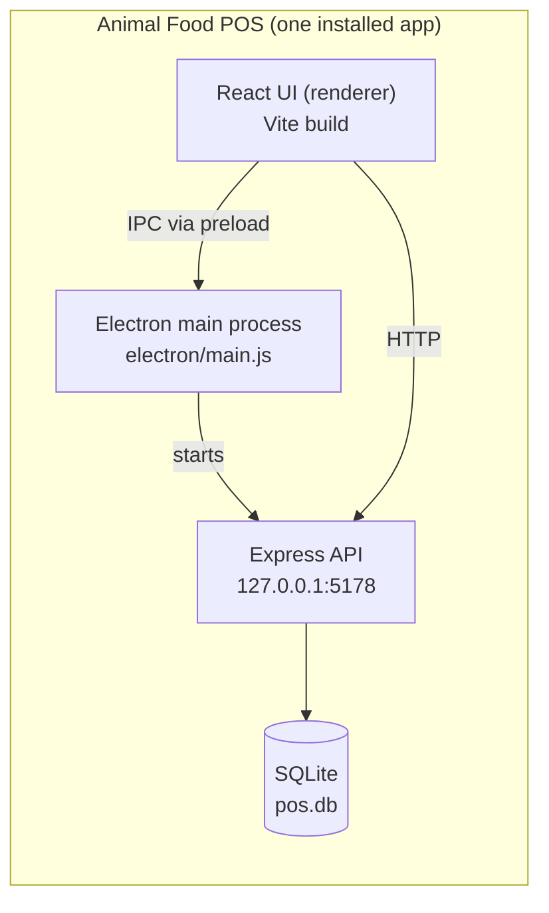

<div align="center">


# Animal Food POS

**An offline-first desktop Point of Sale, Tax Invoicing and Inventory system for animal feed shops and distributors.**


[Features](#features) ·
[Architecture](#architecture) ·
[Getting Started](#getting-started) ·
[Packaging](#building-the-windows-installer) ·
[Printing](#printing-tax-invoices) ·
[Roadmap](#roadmap) ·
[Troubleshooting](#troubleshooting)

</div>

---

## Overview

Animal Food POS is a self-contained Windows application that runs a shop's entire sales counter without needing an internet connection. It combines:

- a **fast point-of-sale screen** for building bills with discounts, VAT and multiple payment methods,
- a **Sri Lankan VAT tax invoice** generator that prints on pre-printed 9.5 × 11 in continuous stationery,
- an **inventory system** that deducts stock automatically on every sale, and
- a **bill history** with search and full invoice reprint.

Everything — the UI, the API server and the database — ships inside one installer. There is no server to host, no subscription, and no internet dependency. Data lives in a single local SQLite file on the shop's own computer.

> **Product direction:** this codebase started as a bespoke system for one feed shop and is being generalised into a modular product that can be sold to retailers, wholesalers and small manufacturers. See the [Roadmap](#roadmap) and `docs/POS-Product-Requirements.md` for the planned module structure.

---

## Features

### Point of Sale
- Item search by **code, name or barcode**
- Cart with per-line **quantity, unit price and discount** (percentage or flat), editable after adding
- **Bill-level discount** (percentage or flat) and configurable **VAT %**
- Payment methods: **Cash** (with change calculation), **Card**, **Credit** (part-payment supported), **Cheque**, **Other**
- Keyboard shortcut: <kbd>Ctrl</kbd> + <kbd>Enter</kbd> completes the sale
- Stock is deducted automatically and every movement is written to a ledger

### Tax Invoice
- Editable **Supplier** and **Purchaser** blocks, each with name, address, telephone, **TIN** and **VAT Reg No** — the supplier defaults to the shop and can be changed per invoice
- **Date of Delivery**, **Place of Supply** and **Additional Information** fields
- Automatic, gap-free **monthly invoice numbering** (e.g. `26SEP_SF1_0001`), restarting each month
- **Total amount in words** (million / thousand system, e.g. *One Million One Hundred Ninety Five Thousand Seven Hundred Rupees Only*)
- Dates in `MM/DD/YYYY`, times in Sri Lanka time (`Asia/Colombo`)
- On-screen preview plus a purpose-built print layout (see [Printing](#printing-tax-invoices))

### Inventory
- Item catalogue with code, barcode, category, unit (`KG`, `PKT`, `PCS`, `BAG`), cost price, selling price, stock quantity and reorder level
- Soft-delete (deactivate) instead of hard delete, so history stays intact
- Full **stock movement ledger** (opening, purchase, sale, return, adjustment, void)

### Bill History
- Search by invoice number or date
- View and reprint any past invoice exactly as issued (items, prices and party details are stored as a snapshot on the bill)
- Permanent delete with a confirmation dialog

---

## Tech Stack

| Layer | Technology |
|---|---|
| Desktop shell | [Electron](https://www.electronjs.org/) with `contextIsolation` on and `nodeIntegration` off |
| UI | React, [Vite](https://vite.dev/), [Tailwind CSS](https://tailwindcss.com/), [shadcn/ui](https://ui.shadcn.com/) (Radix), Sonner toasts |
| API | [Express](https://expressjs.com/) 4, bound to `127.0.0.1` only |
| Validation | [Zod](https://zod.dev/) |
| Database | SQLite via [better-sqlite3](https://github.com/WiseLibs/better-sqlite3), WAL mode, foreign keys on |
| Packaging | [electron-builder](https://www.electron.build/) (NSIS installer) |
| Tooling | npm workspaces, concurrently, wait-on, cross-env, nodemon |

---

## Architecture

The Express API runs **inside Electron's main process**. The React UI talks to it over HTTP on the loopback interface, and talks to Electron itself (for saving PDFs) through a narrow IPC bridge exposed by the preload script.



### Life of a sale

1. The cashier clicks **Complete Sale** (or presses <kbd>Ctrl</kbd>+<kbd>Enter</kbd>); the UI posts the bill to `POST /bills`.
2. The request body is validated with Zod (`backend/src/validation/billSchemas.js`).
3. `billsService.createBill` runs **one SQLite transaction** that:
   1. takes the next number from the monthly counter and builds the invoice number,
   2. recomputes every line, discount, VAT and total on the server, in integer cents,
   3. checks the payment (e.g. cash must cover the grand total),
   4. inserts the bill and its line items (copying item code, name, unit and price onto the line),
   5. writes a `SALE` stock movement and reduces `stock_qty` for each item.
4. If anything fails the whole transaction rolls back — a bill is never half-saved.
5. The saved bill is returned and shown in the receipt preview, ready to print.

### Design decisions worth knowing

| Decision | Why |
|---|---|
| **Money is stored as integer cents** and converted to rupees only at the API boundary | Avoids floating-point rounding errors in totals and VAT |
| **The server recomputes all totals** | The UI is never trusted for money; the stored numbers are always internally consistent |
| **Bill lines snapshot item data** (code, name, unit, rate) | Editing or deactivating an item later never changes an invoice already issued |
| **SQLite `datetime('now')` is UTC** with no marker | The UI parses it explicitly as UTC (`parseSqliteUTC`) and formats in `Asia/Colombo`; otherwise times appear 5½ hours off |
| **API listens on `127.0.0.1` only** | The database is never reachable from the network |
| **Locale forced to `en-US`** (`app.commandLine.appendSwitch('lang', 'en-US')`) | Makes the native date picker use `MM/DD/YYYY` regardless of the PC's regional settings |

---

## Project Structure

```text
AnimalFoodPos/
├── backend/                     # Express API + SQLite (workspace)
│   ├── src/
│   │   ├── db/
│   │   │   ├── connection.js    # opens the DB, enables WAL + FKs, runs migrations
│   │   │   └── migrations/      # NNN_description.sql, applied in order, once each
│   │   ├── routes/              # HTTP layer: parsing, status codes, response mapping
│   │   ├── services/            # business logic and transactions
│   │   ├── validation/          # Zod schemas
│   │   ├── utils/               # money (cents), errors
│   │   ├── app.js               # builds the Express app
│   │   ├── server.js            # startServer / stopServer
│   │   └── dev.js               # standalone dev runner (uses backend/dev.db)
│   └── package.json
├── electron/
│   ├── main.js                  # window, embedded backend, print-to-PDF IPC
│   ├── preload.js               # exposes window.electronAPI to the UI
│   └── build/icon.ico           # Windows app icon (must include a 256×256 image)
├── frontend/                    # React + Vite UI (workspace)
│   ├── public/logo.png          # logo used on invoices
│   └── src/
│       ├── api/                 # HTTP client
│       ├── components/
│       │   ├── pos/             # item picker, cart, bill summary, receipt dialog
│       │   └── ui/              # shadcn/ui primitives
│       ├── config/shopInfo.js   # shop name, address, phone (see Configuration)
│       ├── hooks/               # useItems, useCart, useBillHistory
│       └── lib/                 # currency, bill calculations, error helpers
├── package.json                 # root scripts + electron-builder config
└── README.md
```

---

## Getting Started

### Prerequisites

| Requirement | Notes |
|---|---|
| **Windows 10 / 11** | The supported target. The installer config only builds for Windows. |
| **Node.js 22 LTS** | Recommended. Newer non-LTS releases (e.g. 23) often lack prebuilt `better-sqlite3` binaries and force a slow native compile that can fail. |
| **npm 10+** | Installed with Node. |
| **Visual Studio Build Tools** *(only if a native compile is needed)* | Install the **Desktop development with C++** workload, plus Python 3. |

### Install and run

```bash
git clone <your-repo-url>
cd AnimalFoodPos

npm install        # installs root + backend + frontend workspaces
npm run dev        # starts Vite and Electron together
```

`npm run dev` waits for the Vite server on `http://localhost:5173`, then opens Electron pointing at it with hot reload. Edits to the UI refresh instantly; changes to `electron/` or `backend/` need a full restart.

If Electron complains about a native module (`NODE_MODULE_VERSION` mismatch), rebuild `better-sqlite3` for Electron:

```bash
npm run rebuild
```

### Scripts

| Script | What it does |
|---|---|
| `npm run dev` | Vite dev server **and** Electron, with hot reload |
| `npm run dev:frontend` | Vite dev server only |
| `npm run dev:backend` | Standalone API on `127.0.0.1:5178` via nodemon, using `backend/dev.db` — handy for Postman/curl |
| `npm run dev:electron` | Electron only (expects Vite already running) |
| `npm run rebuild` | Rebuilds `better-sqlite3` against Electron's Node ABI |
| `npm run build:frontend` | Production build of the UI into `frontend/dist` |
| `npm run build` | Builds the UI, then packages the Windows installer into `dist/` |

### Where is the data?

| Mode | Database location |
|---|---|
| `npm run dev` / installed app | `pos.db` inside Electron's per-user data folder, under `%APPDATA%` in a folder named after the app |
| `npm run dev:backend` | `backend/dev.db` |

SQLite runs in WAL mode, so you may also see `pos.db-wal` and `pos.db-shm` beside it. To **reset to a blank database**, close the app and delete all three files; the next launch recreates the schema from the migrations.

---

## Configuration

### Shop details

The shop name, address and phone number printed in the invoice header come from `frontend/src/config/shopInfo.js`, and the logo is `frontend/public/logo.png`. The supplier block on every invoice is **pre-filled from this file** and can still be edited per bill.

```js
export const SHOP_NAME = 'Your Shop Name'
export const SHOP_ADDRESS = 'No. 1, Example Road, Town'
export const SHOP_PHONE = '011-0000000'
export const SHOP_VAT_NUMBER = '000000000-0000'
export const SHOP_TIN = '000000000'
```

> Moving this into the database-backed `settings` table with a first-run setup screen is on the [roadmap](#roadmap) — it is the main step needed before the product can be sold to more than one shop.

### Invoice numbering

Numbers follow `YYMON_SF1_NNNN` — for example `26SEP_SF1_0007`, the seventh invoice of September 2026. A separate counter row is kept per month (`invoice_26SEP`), so numbering restarts at `0001` each month. The `SF1` branch/shop code is currently fixed in `formatInvoiceNo` in `backend/src/services/billsService.js`.

---

## Building the Windows installer

```bash
npm run build
```

This builds the UI and then runs electron-builder, producing:

```text
dist/
├── Animal Food POS Setup 1.0.0.exe   ← distribute this one file
└── win-unpacked/                     ← intermediate build output, do not distribute
```

Give clients **only the `Setup .exe`**. Copying `Animal Food POS.exe` out of `win-unpacked` on its own will not run — Electron needs the DLLs, `resources/` and locale files beside it.

**Notes**
- The installer is a standard NSIS wizard (not one-click) and lets the user choose the install folder.
- The app icon is `electron/build/icon.ico`, referenced from `build.win.icon` in the root `package.json`. It **must contain a 256×256 image** or the build fails.
- `better-sqlite3` is listed under `asarUnpack` because native modules cannot be loaded from inside an `.asar` archive.
- On Windows, electron-builder needs permission to create symbolic links the first time it extracts its signing tools. Enable **Developer Mode** (Settings → Privacy & security → For developers) or run the build from an elevated terminal.
- Installers are currently **unsigned**, so Windows SmartScreen may show a warning on first run. A code-signing certificate fixes this.

---

## Printing tax invoices

The invoice has two renderings:

- **Preview** — the responsive layout shown in the dialog.
- **Print** — a dedicated layout (`PrintInvoice` in `ReceiptPreviewDialog.jsx`) built for **9.5 × 11 in continuous stationery**:
  - the header (shop, invoice number, supplier, purchaser, delivery info) **repeats on every page**,
  - items fill a bordered table, and long invoices **continue across pages under the same invoice number**,
  - the totals, amount in words and payment details sit at the **bottom of the last page only**, with *Continued on next page…* on the others,
  - all text and rules are forced to solid black for impact printers.

Clicking **Print** in the desktop app opens a **Save As** dialog with the **invoice number as the default file name**, and writes a 9.5 × 11 in PDF. Outside Electron it falls back to the browser's print dialog.

### Printer setup (dot-matrix, tractor-fed paper)

1. Create a custom paper size once: <kbd>Win</kbd>+<kbd>R</kbd> → `printui /s /t2` → **Forms** → *Create a new form* → **9.5 in × 11 in** (e.g. `Fanfold 9.5x11`).
2. In the printer's **Printing preferences**, choose that paper size, set the paper source to **Tractor**, and pick the highest quality mode.
3. When printing the PDF, choose **Actual size** (not *Fit to page*) so the layout lines up with the form.
4. Dot-matrix printers print rendered graphics noticeably lighter than text. For multi-part (carbon) stationery, set the printer's paper-thickness lever to the thicker setting.

The number of item rows per page is controlled by `ROWS_PER_FULL_PAGE` and `ROWS_ON_LAST_PAGE` at the top of the print section — adjust them if your stationery fits more or fewer lines.

---

## Database

Schema changes are managed with plain SQL migrations in `backend/src/db/migrations/`.

| Table | Purpose |
|---|---|
| `items` | Product catalogue, prices and current stock |
| `categories` | Item categories |
| `stock_movements` | Ledger of every stock change (`OPENING`, `PURCHASE`, `SALE`, `RETURN`, `ADJUSTMENT`, `VOID`) |
| `bills` | Invoice headers: totals, VAT, payment, supplier and purchaser snapshot, delivery info |
| `bill_items` | Invoice lines, with item details copied at time of sale |
| `counters` | Named sequences (one invoice counter per month) |
| `settings` | Single-row shop configuration *(reserved for the setup screen)* |
| `schema_version` | Which migrations have been applied |

### How migrations run

On startup, `connection.js` reads every `NNN_name.sql` file, sorts them, and applies any whose number is higher than the highest recorded in `schema_version` — each inside its own transaction. A migration therefore runs **exactly once per database** and is never re-run.

- **Never edit a migration that has already shipped.** It will not re-run on existing databases. Add a new numbered file instead.
- Adding a column is a one-line `ALTER TABLE … ADD COLUMN`.
- SQLite cannot alter a `CHECK` constraint; changing one means creating a new table, copying rows across, dropping the old table and renaming.

### Checklist: adding a new field to a bill

Every new bill field has to be threaded through the same five places. Missing one is the most common cause of "I saved it but it doesn't show up".

1. **Migration** — `ALTER TABLE bills ADD COLUMN …` in a new numbered `.sql` file
2. **Validation** — add the field to the Zod schema in `backend/src/validation/billSchemas.js`
3. **Service** — add the column and parameter to `insertBillStmt` and its `.run({...})` in `billsService.js`
4. **Response mapping** — add `camelCase: bill.snake_case` to `toResponse()` in `backend/src/routes/bills.js`
5. **Frontend** — state and payload in `POS.jsx`, the input in `BillSummary.jsx`, and the display in `ReceiptPreviewDialog.jsx`

---

## API reference

The API is internal to the app and listens on `http://127.0.0.1:5178`. All money values in requests and responses are in **rupees** (the database stores cents).

### Bills

| Method | Path | Description |
|---|---|---|
| `POST` | `/bills` | Create a bill; deducts stock and returns the saved invoice |
| `GET` | `/bills` | List bills, newest first. Query: `search`, `limit` (max 500), `offset` |
| `GET` | `/bills/:id` | Full invoice with line items |
| `DELETE` | `/bills/:id` | Permanently delete a bill and its lines (`204`) |

**Create bill — example body**

```json
{
  "items": [
    { "itemId": 1, "qty": 25, "rate": 1850, "discountType": "PERCENT", "discountValue": 2 }
  ],
  "billDiscountType": "FLAT",
  "billDiscountValue": 500,
  "vatPercent": 18,
  "paymentMethod": "CASH",
  "amountPaid": 60000,
  "supplierName": "Example Feed",
  "supplierTin": "000000000",
  "customerName": "Example Farms (Pvt) Ltd",
  "customerTin": "111111111",
  "deliveryDate": "2026-09-30",
  "placeOfSupply": "Kurunegala",
  "additionalInfo": "Domestic sales"
}
```

**Validation rules**
- `items` needs at least one line; `qty` must be positive.
- A discount type and value must be supplied **together**; a percentage cannot exceed 100.
- `amountPaid` is **required** for `CASH` and must cover the grand total. For `CARD`, `CHEQUE` and `OTHER` the server treats the bill as paid in full. `CREDIT` accepts an optional part-payment.
- Validation failures return `400` with the Zod issue list. Unknown fields are rejected.

### Items

Item endpoints support create, list (with an `includeInactive` option), get, update and **soft delete** (deactivate). Items with duplicate codes or barcodes return a `409 Conflict`.

---

## Roadmap

The detailed requirements and open client questions live in [`docs/POS-Product-Requirements.md`](docs/POS-Product-Requirements.md). In summary:

**Product hardening**
- [ ] Multi-user login with roles (Cashier / Manager / Admin / Owner)
- [ ] Audit trail for edits, voids and deletions
- [ ] Returns and refunds with credit notes
- [ ] Hold / park a sale; quotations and proforma invoices
- [ ] First-run setup wizard backed by the `settings` table (removes hard-coded shop details)
- [ ] Automatic backups, auto-update and licensing

**New modules**
- [ ] **Purchasing** — suppliers, purchase orders, goods received, payables
- [ ] **Manufacturing** — bill of materials, production runs, cost roll-up for feed mixed from raw materials
- [ ] **Inventory+** — stock adjustments, valuation, batch/expiry, multi-location
- [ ] **Wholesale vs retail** classification with separate pricing and reporting
- [ ] **Profit and VAT reporting** — per-invoice profit; weekly, monthly and yearly summaries; output VAT vs input VAT; export to PDF / Excel
- [ ] **Customers and credit** — persistent customer records and receivables

---

## Troubleshooting

| Symptom | Cause and fix |
|---|---|
| `listen EADDRINUSE 127.0.0.1:5178` | Another copy is still running (a previous dev session, the installed app, or `dev:backend`). Find it with `netstat -ano \| findstr :5178` and stop it with `taskkill /PID <pid> /F`. Only one instance can own the port. |
| `Cannot find module …node-gyp / nodemon / concurrently` | An earlier `npm install` failed partway. Delete `node_modules` (root and `backend/`), then run `npm install` again. |
| `better-sqlite3` fails to compile (`node-gyp`, *Could not find any Visual Studio installation*) | Switch to **Node 22 LTS** so a prebuilt binary is used, or install the Visual Studio **Desktop development with C++** workload and Python. |
| `NODE_MODULE_VERSION` mismatch on launch | The native module was built for a different runtime. Run `npm run rebuild` for Electron. Note that `npm run dev:backend` uses plain Node and needs the Node build, so switching between the two may require rebuilding. |
| `Cannot create symbolic link : A required privilege is not held by the client` during `npm run build` | Enable Windows **Developer Mode** or use an elevated terminal, then clear the cache: `Remove-Item -Recurse -Force "$env:LOCALAPPDATA\electron-builder\Cache\winCodeSign"` |
| `image … icon.ico must be at least 256x256` | Regenerate the `.ico` so it includes a 256×256 image (use a converter that lets you select sizes, and start from a PNG of at least 256×256). |
| Invoice time is 5½ hours wrong | A date is being parsed as local time. SQLite timestamps are UTC — always parse with `parseSqliteUTC` and format with `timeZone: 'Asia/Colombo'`. |
| New field saves but does not appear on the invoice | `toResponse()` in `routes/bills.js` was not updated — see the [field checklist](#checklist-adding-a-new-field-to-a-bill). |
| Printed pages come out faint | Graphics printing on dot-matrix hardware is inherently light. Check the paper-thickness lever and ribbon, use the highest quality mode, and see [Printer setup](#printer-setup-dot-matrix-tractor-fed-paper). |
| Need a clean database | Close the app and delete `pos.db`, `pos.db-wal` and `pos.db-shm` from the data folder. |

---

## Known behaviour

- **Deleting a bill is permanent and does not restore stock.** This is intentional for the current client. A future *void* workflow will keep the record and offer stock restoration.
- Invoice numbers are **not reused or renumbered** after a deletion, so gaps can appear in the sequence.
- Installers are unsigned (see [Building the Windows installer](#building-the-windows-installer)).

---

## License

Proprietary — all rights reserved.
